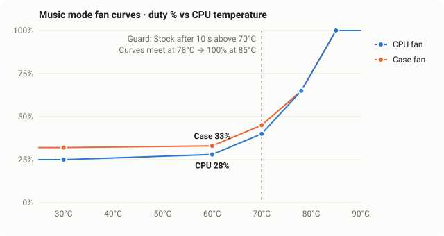

<div align="center">


# Music Mode

**One click in your Omarchy bar: quiet fans for listening, stock fans for everything else — with a thermal safety net.**

<br />

[](https://github.com/qwerpik/omarchy-music-mode/actions/workflows/test.yml)
&nbsp;
[](https://gitlab.com/coolercontrol/coolercontrol)
&nbsp;
[](#install)
&nbsp;
[](LICENSE)

---

Bar toggle • CoolerControl API • Auto-revert above 70 °C • No root • ~100 lines of bash

[Install](#install) • [How it works](#how-it-works) • [The curves](#the-curves) • [CoolerControl setup](docs/COOLERCONTROL.md) • [Contributing](CONTRIBUTING.md)

</div>

<br />

Headphones on, fans whooshing up and down every time a browser tab does something?
**Music mode** flips [CoolerControl](https://gitlab.com/coolercontrol/coolercontrol)
to flat, quiet, smoothed fan curves with one click on a headphone icon in the
Omarchy bar — and a small guard flips it back to stock the moment the machine
actually gets hot, so you can forget it's on.

> [!TIP]
> **Try it in 60 seconds** (after the [one-time CoolerControl setup](docs/COOLERCONTROL.md))
> ```bash
> git clone https://github.com/qwerpik/omarchy-music-mode.git
> cd omarchy-music-mode
> ./install.sh          # asks once for your CoolerControl password
> music-mode toggle     # {"music":true}
> ```

<table>
<tr>
<td width="33%" valign="top">

**🎧 One click**
Headphone icon in the bar: dimmed = stock, lit = music. Tooltip says which, click toggles.

</td>
<td width="33%" valign="top">

**🌡️ Can't overheat**
`music-mode-guard` watches CPU and GPU. Above **70 °C for 10 s** it switches back to Stock and tells you why.

</td>
<td width="33%" valign="top">

**🔒 Least privilege**
Talks to CoolerControl's local API as your user. Password in a 600 file, sent over stdin — never in `ps`.

</td>
</tr>
</table>

## Install

Requires [CoolerControl](https://gitlab.com/coolercontrol/coolercontrol) 5.x with
two modes named **Stock** and **Music** ([setup guide](docs/COOLERCONTROL.md)),
plus `curl`, `jq` and `notify-send`.

```bash
git clone https://github.com/qwerpik/omarchy-music-mode.git
cd omarchy-music-mode
./install.sh
```

The installer copies two scripts to `~/.local/bin`, the bar widget to
`~/.config/omarchy/plugins/user.music-mode/`, enables the guard as a user
service, and asks for your **CoolerControl password** (the one you log in to the
CoolerControl app with) if it isn't stored yet.

Then add the widget to a bar section in `~/.config/omarchy/shell.json`:

```jsonc
"right": [
  { "id": "user.music-mode" },
  // …
]
```

## Usage

| Command | Output |
| :--- | :--- |
| `music-mode` / `music-mode status` | `{"music":false}` |
| `music-mode toggle` | switches and prints the new state |
| `music-mode music` | force Music |
| `music-mode stock` | force Stock |

Bind it to a key if you like — Omarchy:
`o.bind("SUPER + F9", "Music fan mode", "~/.local/bin/music-mode toggle")`.

## How it works

```
 bar icon ──click──▶ music-mode toggle ──▶ CoolerControl API (localhost:11987)
     ▲                    │                  POST /login · GET /modes
     └── refresh (IPC) ◀──┘                  POST /modes-active/<uid>

 music-mode-guard (user service, every 2 s)
   k10temp Tccd1 / amdgpu edge  >70 °C for 10 s  &&  Music active
     └──▶ music-mode stock  +  notification "Music mode off"
```

- **music-mode** logs in, looks the modes up **by name** (UIDs differ per machine),
  activates one and prints JSON the widget understands.
- **The widget** polls every 5 s, so changes made in the CoolerControl app show up
  too, and refreshes instantly over Quickshell IPC after a toggle.
- **music-mode-guard** only ever moves you *to* Stock, never away from it.
  It picks sensors automatically (`k10temp` Tccd1 → Tctl, Intel `coretemp`,
  `amdgpu` edge); override with `MUSIC_GUARD_CPU` / `MUSIC_GUARD_GPU`.

Everything is configurable through environment variables —
see the [reference table](docs/COOLERCONTROL.md#configuration-reference).

## The curves

<p align="center">
  
</p>

| °C | CPU fan | Case fan |
| ---: | ---: | ---: |
| 30 | 25 % | 32 % |
| 60 | 28 % | 33 % |
| 70 | 40 % | 45 % |
| 78 | 65 % | 65 % |
| 85 | 100 % | 100 % |

Nearly flat until 60 °C, then a normal curve — smoothed by a CoolerControl
function (4 s response delay, 3 °C deviance, 3 % max step) so the fans don't
audibly hunt. These are the values from the reference machine (Ryzen 5 5600X,
RX 7600 XT, MSI nct6687 board). Tune them to your fans.

## Uninstall

```bash
./uninstall.sh            # keeps the password file
./uninstall.sh --purge    # removes ~/.config/music-mode too
```

Your CoolerControl modes and profiles are never touched.

## Contributing

`make check` runs the tests (against a mock CoolerControl API and fake sensors —
no hardware needed) and `shellcheck`. See [CONTRIBUTING.md](CONTRIBUTING.md).

## License

[MIT](LICENSE)
